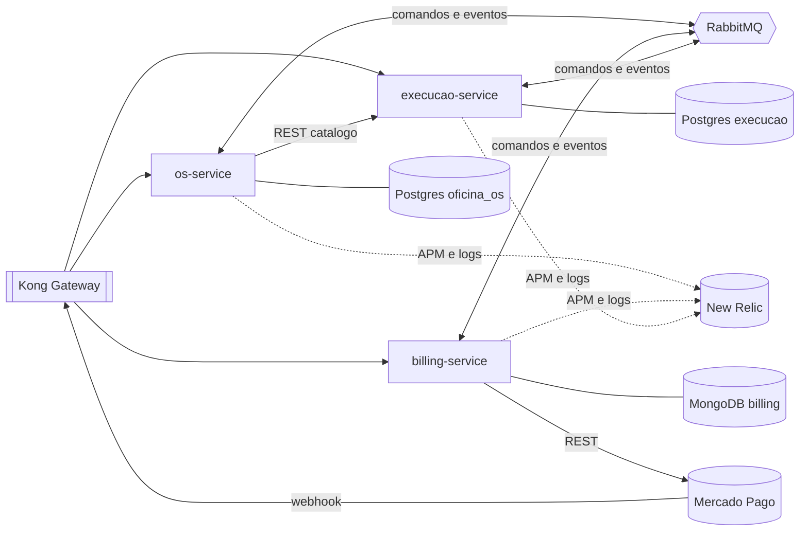
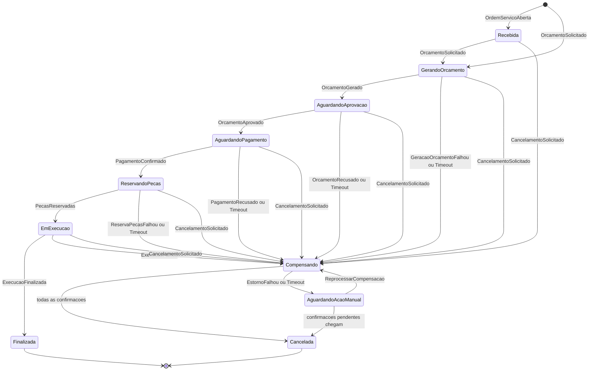

# oficina-os-service

Orquestrador da **Saga de Ordem de Serviço** da Oficina (Tech Challenge — Fase 4, SOAT/FIAP). É um dos 3 microsserviços .NET 10 que substituem o monólito `fiap-app`:

| Serviço | Responsabilidade | Banco |
|---|---|---|
| **oficina-os-service** (este) | Clientes, veículos, usuários da equipe, OS e **Saga orquestrada** | PostgreSQL (`oficina_os`, Railway) |
| [oficina-billing-service](https://github.com/MathboyL3/oficina-billing-service) | Orçamento e pagamento (Mercado Pago) | MongoDB |
| [oficina-execucao-service](https://github.com/MathboyL3/oficina-execucao-service) | Catálogo, estoque, reserva de peças e fila de execução | PostgreSQL |

Infra do cluster (Kong, RabbitMQ): [fiap-infra-k8s](https://github.com/MathboyL3/fiap-infra-k8s). Autenticação do cliente por CPF: [fiap-auth-lambda](https://github.com/MathboyL3/fiap-auth-lambda).
Arquitetura completa, justificativas e tecnologias: [`docs/ARQUITETURA-FASE4.md`](docs/ARQUITETURA-FASE4.md). Roteiro do vídeo: [`docs/ROTEIRO-VIDEO-FASE4.md`](docs/ROTEIRO-VIDEO-FASE4.md).

## Responsabilidades

- CRUD de clientes e veículos; abertura da OS (`POST /api/ordens-servico`), itens, diagnóstico, orçamento, cancelamento e entrega.
- **Identidade da equipe:** `POST /api/auth/login` emite o JWT (HS256) de `Atendente`, `Mecanico` e `Gerente`; `POST /api/auth/bootstrap` cria o primeiro usuário. O cliente continua autenticando por CPF na `fiap-auth-lambda` (role `Cliente`). Os outros serviços só validam o JWT (mesmo `Issuer`/`Audience`/`Secret`).
- **Saga orquestrada** (`OrdemServicoStateMachine`, MassTransit State Machine): dona do `StatusOS` a partir de `enviar-orcamento`. A API só muta o agregado em `Recebida`/`EmDiagnostico` e em `Finalizada → Entregue`.
- Valida os itens consultando o catálogo do execucao-service via REST (`Catalogo:BaseUrl`): descrição e preço vêm sempre do catálogo, nunca do request.

## Arquitetura



Camadas (Clean Architecture): `Os.Domain` → `Os.Application` (casos de uso, Saga, contratos) → `Os.Infrastructure` (EF Core/Npgsql, MassTransit, Quartz, HttpClient do catálogo) → `Os.Api` (controllers, Swagger na raiz `/`). Testes: `tests/Os.Tests` (xUnit) e `tests/Os.Bdd` (Reqnroll).

## Saga orquestrada: por quê

O fluxo da OS tem ordem estrita (orçamento → aprovação → pagamento → reserva → execução) e as compensações dependem do ponto em que a falha ocorre. Um **orquestrador** central deixa o estado explícito (consultável em `GET /api/ordens-servico/{id}`, campo `saga`), simplifica os testes BDD e a demonstração. Em troca, o os-service conhece os *comandos* dos outros serviços (acoplamento por contrato de mensagem, **nunca por banco**). Uma coreografia espalharia as regras de compensação pelos três serviços e dificultaria rastrear o fluxo.

Como o estado é persistido em `os_saga_state` (concorrência otimista) e as publicações saem pelo **outbox transacional EF**, a Saga sobrevive a reinícios. Os timeouts usam **Quartz.NET persistente** no mesmo Postgres (tabelas `QRTZ_*`), sem plugin do RabbitMQ.

### Estados e transições



- Todo estado de espera agenda um `TimeoutEtapa` ao entrar e o desagenda ao sair. `EmExecucao` é exceção: o timeout (`Saga:Timeouts:EmExecucao`, 30 dias) **não compensa**, só loga erro com o alerta `saga_em_execucao_atrasada`.
- `Compensando` publica, uma vez, os comandos aplicáveis e espera as confirmações: `CancelarOrcamento` → `OrcamentoCancelado` (sempre); `LiberarPecas` → `PecasLiberadas` (se já houve reserva ou a origem é `ReservandoPecas`/`EmExecucao`); `EstornarPagamento` → `PagamentoEstornado` (se há `PagamentoId`).
- Pagamento que chega com a Saga já em `Compensando` e sem pagamento conhecido dispara `EstornarPagamento` (corrida pagamento × cancelamento).
- Eventos tardios ou duplicados são descartados (`OnUnhandledEvent → Ignore`). Falha técnica em consumidor: retry exponencial (3x) e depois fila `_error` — não dispara compensação.
- `AguardandoAcaoManual` **não finaliza** a instância; `Finalizada` e `Cancelada` sim (`SetCompletedWhenFinalized`). O histórico durável fica em `historico_status` da OS.

| Estado da Saga | `StatusOS` aplicado pela Saga |
|---|---|
| `GerandoOrcamento`, `AguardandoAprovacao` | `AguardandoAprovacao` |
| `AguardandoPagamento` | `AguardandoPagamento` |
| `ReservandoPecas` | (sem mudança) |
| `EmExecucao` | `EmExecucao` |
| `Finalizada` | `Finalizada` |
| `Cancelada` | `Cancelada` (com motivo; idempotente) |
| `AguardandoAcaoManual` | sem mudança; entrada em `historico_status` "compensação pendente: motivo" |

### Mensagens (`Oficina.Contracts`, em `src/Os.Application/Contracts/Mensagens.cs`)

Todas carregam `OrdemServicoId` (CorrelationId da Saga) e `Timestamp`. Os comandos são **publicados** (`Publish`); cada tipo de comando tem um único serviço consumidor.

| Direção | Mensagens |
|---|---|
| API → Saga (publica) | `OrdemServicoAberta`, `OrcamentoSolicitado`, `CancelamentoSolicitado`, `ReprocessarCompensacao` |
| Saga → billing (publica) | `GerarOrcamento`, `CriarCobranca`, `CancelarOrcamento`, `EstornarPagamento` |
| Saga → execucao (publica) | `ReservarPecas`, `EnfileirarExecucao`, `LiberarPecas` |
| billing → Saga (consome) | `OrcamentoGerado`, `GeracaoOrcamentoFalhou`, `OrcamentoAprovado`, `OrcamentoRecusado`, `CobrancaCriada`, `PagamentoConfirmado`, `PagamentoRecusado`, `PagamentoEstornado`, `EstornoFalhou`, `OrcamentoCancelado` |
| execucao → Saga (consome) | `PecasReservadas`, `ReservaPecasFalhou`, `ExecucaoIniciada`, `ExecucaoFinalizada`, `ExecucaoFalhou`, `PecasLiberadas` |
| Saga (publica, para terceiros) | `OrdemServicoFinalizada`, `OrdemServicoCancelada` |
| Interna (Quartz) | `TimeoutEtapa` |

## API

Swagger na raiz (`/`). Rotas diretas em `http://localhost:5001`; via Kong: `http://localhost:32080/os/api/...`. JWT Bearer em tudo, salvo indicação.

| Método e rota | Roles |
|---|---|
| `POST /api/auth/login` | anônimo |
| `POST /api/auth/bootstrap` | anônimo (só cria se NÃO existir nenhum usuário; o usuário criado é sempre Gerente, o `role` do body é ignorado; depois disso 409 `Bootstrap já realizado.`) |
| `POST /api/auth/usuarios` | Gerente |
| `POST /api/clientes`, `GET /api/clientes`, `GET /api/clientes/{id}`, `GET /api/clientes/por-documento/{documento}`, `PATCH /api/clientes/{id}` | Atendente, Gerente |
| `DELETE /api/clientes/{id}` | Gerente |
| `POST /api/veiculos`, `GET /api/veiculos/{id}`, `GET /api/veiculos/por-cliente/{clienteId}` | Atendente, Gerente |
| `DELETE /api/veiculos/{id}` | Gerente |
| `POST /api/ordens-servico` (abre a OS e inicia a Saga) | Atendente, Gerente, Mecanico |
| `GET /api/ordens-servico` (`?status=`), `GET /api/ordens-servico/{id}` (status + histórico + `saga`), `GET /api/ordens-servico/painel` | Atendente, Gerente, Mecanico |
| `POST /api/ordens-servico/{id}/itens` (`{servicos:[{id,quantidade}], pecas:[{id,quantidade}]}`; substitui os itens) | Atendente, Gerente, Mecanico |
| `POST /api/ordens-servico/{id}/diagnostico` | Mecanico, Gerente |
| `POST /api/ordens-servico/{id}/enviar-orcamento`, `/entregar`, `/cancelar` | Atendente, Gerente, Mecanico |
| `GET /api/ordens-servico/metricas/tempo-medio` | Gerente |
| `GET /api/ordens-servico/publico/{id}/status` | anônimo |
| `GET /api/admin/sagas?estado=` (padrão `AguardandoAcaoManual`) | Gerente |
| `POST /api/admin/ordens-servico/{id}/reprocessar-compensacao` | Gerente |
| `GET /internal/clientes/por-documento/{cpf}` (uso interno, ver abaixo) | sem JWT; header `X-Service-Key` |
| `GET /health/live`, `GET /health/ready` (Postgres + RabbitMQ) | anônimo |

`POST .../cancelar` responde 409 se a Saga está em `Finalizada`/`Cancelada`/`Compensando`/`AguardandoAcaoManual`. Coleção Postman: [`docs/oficina-os-service.postman_collection.json`](docs/oficina-os-service.postman_collection.json).

## Configuração

| Chave (env com `__`) | Padrão / uso |
|---|---|
| `ConnectionStrings__Postgres` | Postgres do `oficina_os` (o `Database.Migrate()` cria o database/tabelas no startup; Quartz usa a mesma conexão) |
| `RabbitMq__Host/Port/VirtualHost/Username/Password` | `localhost`/`5672`/`/`/`guest`/`guest` |
| `Catalogo__BaseUrl` | `http://localhost:5003` (execucao-service) |
| `Jwt__Issuer/Audience/Secret/ExpirationMinutes` | `Oficina.Api`/`Oficina.Api`/obrigatório em produção/`60` |
| `InternalApi__ServiceKey` | vazio (endpoints `/internal/*` respondem 503); valor de dev no `appsettings.Development.json`/docker-compose; em produção vem do Secret do K8s (`OS_INTERNAL_SERVICE_KEY` no `bootstrap-secrets.ps1`) e a mesma chave é configurada na function |
| `Saga__Timeouts__GerandoOrcamento` · `AguardandoAprovacao` · `AguardandoPagamento` · `ReservandoPecas` · `EmExecucao` · `Compensando` | `00:05:00` · `3.00:00:00` · `1.00:00:00` · `00:05:00` · `30.00:00:00` · `00:15:00` |
| `NEW_RELIC_LICENSE_KEY` | habilita o agente APM |

Segredos (`Jwt__Secret`, `InternalApi__ServiceKey`, connection string, license key) vêm de variável de ambiente / Secret do Kubernetes. O segredo do `appsettings.Development.json` é só de desenvolvimento.

## Rodando localmente

Requer Docker. Os 3 serviços compartilham a rede externa `oficina-dev` (os containers se enxergam pelo nome):
1. Uma vez: `docker network create oficina-dev`
2. Suba o **os-service primeiro** (traz o RabbitMQ): `docker compose up -d --build` em `oficina-os-service`
3. Depois `oficina-execucao-service` e `oficina-billing-service` (mesmo comando).

URLs: os `http://localhost:5001`, billing `http://localhost:5002`, execucao `http://localhost:5003` (Swagger em `/`, `/health/ready`). RabbitMQ management: http://localhost:15672 (guest/guest). O billing sobe com `MercadoPago__Modo=Fake` (o pagamento é aprovado na hora).

Postgres do os: porta host **5435** (→ 5432 no container), pois a 5433 costuma estar ocupada. Fora do compose, o `src/Os.Api/appsettings.json` aponta para `localhost:5433`; ajuste para `5435` ao usar este Postgres do compose.

**Roteiro rápido (demo):** `bootstrap` → `login` → cadastrar serviço/peça no execucao-service → cliente + veículo → abrir OS → `itens` → `enviar-orcamento` → aprovar no billing → (Fake paga) → `GET /api/ordens-servico/{id}` até `EmExecucao` → `iniciar`/`finalizar` no execucao-service → `Finalizada` → `entregar`.

## Runbook: compensação pendente (`AguardandoAcaoManual`)

A Saga chega a `AguardandoAcaoManual` quando o estorno falha (`EstornoFalhou`) ou as confirmações da compensação não chegam em 15 min. Há log de erro `saga.alerta saga_acao_manual` (alerta no New Relic), entrada "compensação pendente: ..." no histórico da OS e o `Pagamento` fica `EstornoPendente` no billing.
1. `GET /api/admin/sagas` (Gerente) lista as pendências.
2. Conferir o pagamento no painel do Mercado Pago (o MP é a fonte da verdade).
3. `POST /api/admin/ordens-servico/{id}/reprocessar-compensacao` (Gerente, 202): reenvia só os comandos sem confirmação. Se o estorno continuar falhando, estornar manualmente no MP e usar `POST /api/pagamentos/{id}/reprocessar-estorno` no billing.

Runbook de pagamento após cancelamento (`pagamento_apos_cancelamento`): ver o [README do billing-service](https://github.com/MathboyL3/oficina-billing-service#runbook-pagamento-após-cancelamento-e-estorno-pendente).

## Observabilidade

Serilog JSON + agente New Relic; `traceparent` W3C propagado nas mensagens MassTransit (mesmo `trace.id` ao longo da Saga). Logs `saga.estado` alimentam o painel "Saga" do dashboard [`observability/dashboard-fase4.json`](observability/dashboard-fase4.json) (ver [`observability/README.md`](observability/README.md)).

## Testes e cobertura

```bash
dotnet test Os.slnx   # unitários (xUnit) + BDD (Reqnroll); falha se a cobertura de linhas < 80%
```

BDD em `tests/Os.Bdd/Features/SagaOrdemServico.feature` (5 cenários, state machine com `ITestHarness`): caminho feliz, orçamento recusado, pagamento recusado, falta de peças (estorno + cancelamento) e falha na execução (libera peças + estorno). `Os.Tests` exige **Docker** (Testcontainers/Postgres).

Evidência (execução real de `dotnet test Os.slnx` em 2026-11-14; 205 testes unitários + 5 BDD, 0 falhas). Cobertura do `Os.Tests` (a do `Os.Bdd`, isolada, é parcial e não conta para o gate):

```
+-------------------+--------+--------+--------+
| Module            | Line   | Branch | Method |
+-------------------+--------+--------+--------+
| Os.Api            | 68.98% | 33.33% | 65.85% |
+-------------------+--------+--------+--------+
| Os.Application    | 92.61% | 73.8%  | 92.48% |
+-------------------+--------+--------+--------+
| Os.Domain         | 88.19% | 76.31% | 87.87% |
+-------------------+--------+--------+--------+
| Os.Infrastructure | 94.95% | 69.64% | 94.44% |
+-------------------+--------+--------+--------+

+---------+--------+--------+--------+
|         | Line   | Branch | Method |
+---------+--------+--------+--------+
| Total   | 89.08% | 72.63% | 89.08% |
+---------+--------+--------+--------+
| Average | 86.18% | 63.27% | 85.16% |
+---------+--------+--------+--------+
```

Exclusões: `Program.cs`, `DependencyInjection.cs`, `Migrations`, `Persistence/Configurations`, `*DbContextFactory`; `MessagingExtensions` é `[ExcludeFromCodeCoverage]` (só configura MassTransit/Quartz).

## Deploy no Kubernetes

Pré-requisitos:
- `fiap-infra-k8s` aplicado (namespace `oficina`, RabbitMQ com o Secret `rabbitmq-credentials` e Kong).
- Variáveis de ambiente: `OS_DB_CONNECTION`, `JWT_SECRET`, `NEW_RELIC_LICENSE_KEY`, `GHCR_USER` e `GHCR_TOKEN` (PAT com `read:packages`).

Passos (a partir da raiz do repo):
1. `./k8s/bootstrap-secrets.ps1` — cria/atualiza os Secrets e o `ghcr-pull` de forma idempotente (falha se uma env obrigatória estiver vazia). `k8s/secret.example.yaml` documenta as chaves.
2. `kubectl apply -k k8s/`

O Service é ClusterIP (porta 80); o acesso externo é pelo Kong (NodePort **32080**): `/os/api/...`. HPA 2–6 réplicas (CPU 60% / memória 75%). O banco é o Railway (sem manifesto de banco). RabbitMQ UI no cluster: NodePort **31672**.

## CI/CD

Pipeline em `.github/workflows/ci-cd.yml` (GitHub Actions).

| Job | Quando | O que faz |
|-----|--------|-----------|
| `build-test-sonar` | PR e push na `main` | restore, build Release, `dotnet test` com gate de cobertura >= 80% (coverlet; sempre ativo) e, se `SONAR_TOKEN` existir, análise SonarCloud com quality gate. Publica o artifact `coverage`. |
| `image` | push na `main` | build da imagem Docker e push para o GHCR (`:<sha>` e `:latest`, nome em minúsculas) via `GITHUB_TOKEN`. |
| `deploy` | push na `main`, após `image` | runner self-hosted (`environment: producao`): fixa a tag `<sha>` no `k8s/kustomization.yaml`, `kubectl apply -k k8s/` e `rollout status`. |

**Secrets/vars necessários**
- `secrets.SONAR_TOKEN` (opcional: sem ele a análise Sonar é pulada), `vars.SONAR_PROJECT_KEY`, `vars.SONAR_ORGANIZATION`.
- Environment `producao` (pode exigir aprovação manual).
- `GITHUB_TOKEN` (automático) com `packages: write` para publicar no GHCR.
- Deploy: runner self-hosted com `kubectl` apontando para o cluster (docker-desktop), `fiap-infra-k8s` aplicado e `k8s/bootstrap-secrets.ps1` já executado.

**Proteger a `main` (passo manual, não configurável por arquivo):** Settings → Branches → Add rule para `main`: *Require a pull request before merging* e *Require status checks to pass* com o check `build-test-sonar`.

## Integração com a fiap-auth-lambda

Na Fase 4, a `fiap-auth-lambda` consulta o cliente por CPF via `GET /internal/clientes/por-documento/{cpf}` (header `X-Service-Key`), sem acessar o banco `oficina_os`, que pertence só a este serviço.
