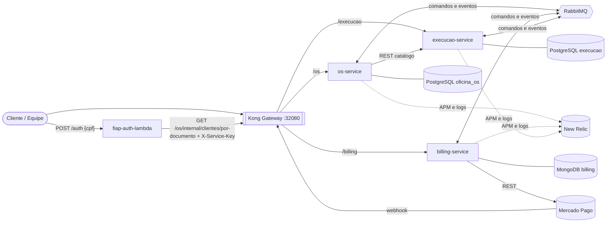
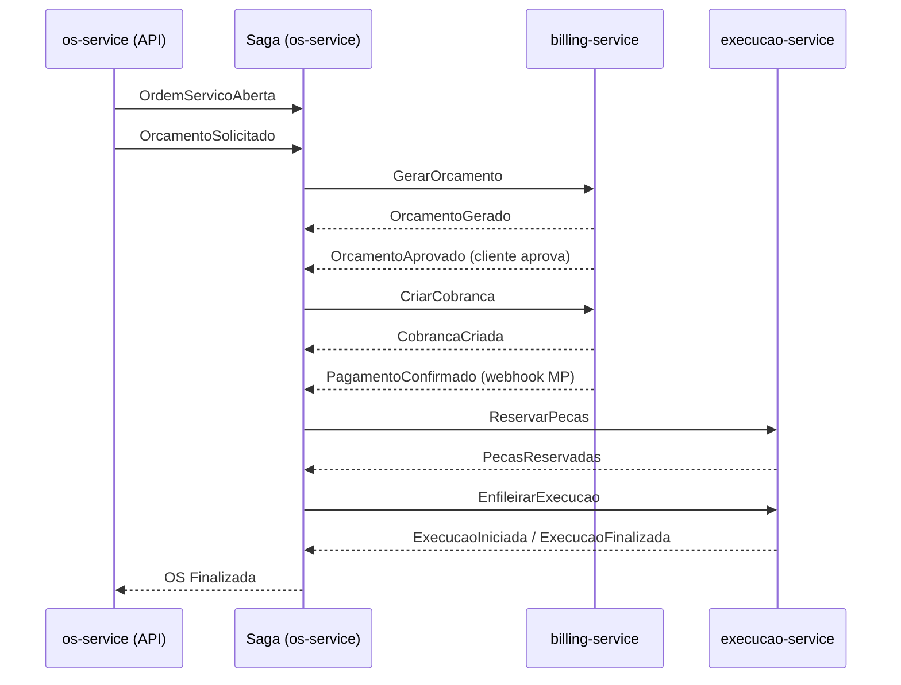
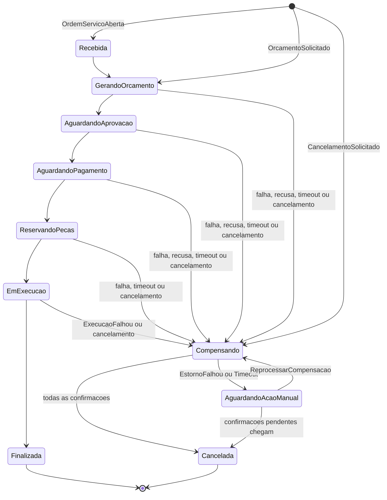

# Arquitetura — Fase 4 (Microsserviços + Saga orquestrada)

Documento-base do PDF de entrega do Tech Challenge Fase 4 (SOAT/FIAP). O monólito `fiap-app` (Fase 3) foi dividido em **3 microsserviços independentes** — cada um com repositório, banco, Dockerfile, manifestos Kubernetes e pipeline próprios — coordenados por **Saga orquestrada** sobre **RabbitMQ**, com pagamento via **Mercado Pago** e deploy automatizado em Kubernetes.

## 1. Repositórios

| Repositório | Papel |
|---|---|
| `oficina-os-service` | Clientes, veículos, equipe, OS e **orquestrador da Saga** |
| `oficina-billing-service` | Orçamento e pagamento (Mercado Pago, webhook, estorno) |
| `oficina-execucao-service` | Catálogo de serviços/peças, estoque, reservas e fila de execução |
| `fiap-infra-k8s` | Terraform: namespace, RabbitMQ, Kong (API Gateway) e rotas |
| `fiap-infra-db` | Postgres gerenciado (Railway) onde vive o database `oficina_os` |
| `fiap-auth-lambda` | Login do cliente por CPF → JWT (Railway Function); consulta o cliente no os-service via Kong (`/os/internal`), sem acessar banco |

## 2. Visão geral

Regra de ouro: **nenhum serviço acessa o banco de outro** (verdadeira em todos os componentes, inclusive a function de autenticação). A integração é por mensagens (RabbitMQ) e por REST: o os-service valida itens no catálogo do execucao-service e a `fiap-auth-lambda` consulta o cliente no os-service.

**Login do cliente por CPF:** o cliente chama a function (`POST /auth {"cpf"}`) → a function chama o Kong (`GET /os/internal/clientes/por-documento/{cpf}` com o header `X-Service-Key`) → o Kong encaminha ao os-service, dono do database `oficina_os`, que responde `{id,nome,email}` → a function emite o JWT HS256 com role `Cliente`, aceito pelos 3 serviços (mesmo `Issuer`/`Audience`/`Secret`).

**Segurança do acesso interno e da identidade:**
- Chave de serviço: `X-Service-Key` = `InternalApi__ServiceKey` no os-service (`OS_INTERNAL_SERVICE_KEY` no `bootstrap-secrets.ps1`) = `OS_SERVICE_KEY` na function. Comparação em tempo constante; sem chave configurada o endpoint responde 503 e, com chave errada, 401. A rota é pública no Kong (a function roda fora do cluster), então a chave é segredo e deve ser **rotacionada nos dois lados** (Secret do K8s e variável da function).
- `POST /api/auth/bootstrap` só funciona com **0 usuários** (depois, 409) e cria **sempre um Gerente**.
- O CPF é **mascarado** nos logs (inclusive no request log).

## 3. Por que essa divisão

| Serviço | Motivo da fronteira |
|---|---|
| os-service | Dono do ciclo de vida da OS e da identidade; precisa ser relacional (cliente → veículo → OS → itens → histórico) e concentra o estado da Saga e os timeouts |
| billing-service | Domínio financeiro com ciclo próprio (webhook, idempotência, estorno). Documentos de orçamento/pagamento aninham itens e não têm joins: **MongoDB** (com replica set para transações + outbox) |
| execucao-service | Estoque exige consistência forte (reserva/consumo atômicos) e fila de trabalho do mecânico; **PostgreSQL** |

Bancos: 2 SQL (PostgreSQL) e 1 NoSQL (MongoDB), atendendo ao requisito do enunciado.

## 4. Saga orquestrada

O orquestrador (`OrdemServicoStateMachine`, no os-service) conduz: **abre OS → gera orçamento → aprovação → cobrança/pagamento → reserva de peças → execução → finalização**, com **compensação** em cada etapa que pode falhar.

Compensações (estado `Compensando`): `CancelarOrcamento`, `LiberarPecas` e `EstornarPagamento`, conforme o ponto da falha; se o estorno falha ou o prazo estoura, a Saga vai a `AguardandoAcaoManual` e há reprocessamento por `POST /api/admin/ordens-servico/{id}/reprocessar-compensacao`. Tabela de mensagens e runbook: [README do os-service](../README.md).

### Garantias de consistência
- **Outbox transacional** em cada serviço (EF Core no os/execucao, MongoDB no billing): o dado e a mensagem confirmam juntos; o inbox descarta reentregas (idempotência por `MessageId`).
- **Concorrência otimista** no estado da Saga e nos agregados.
- **Timeouts** persistentes via Quartz.NET (sobrevivem a reinício).
- **Retry exponencial** (3x) em consumidores e fila `_error` para falhas técnicas; compensação só para falhas de negócio.

## 5. Mercado Pago

Integração REST atrás de `IGatewayPagamento`: Checkout Pro (`/checkout/preferences`), consulta de pagamento e estorno (`/v1/payments/{id}/refunds`). O webhook (`POST /webhooks/mercadopago`) valida `x-signature` (HMAC-SHA256 sobre `id:{data.id};request-id:{x-request-id};ts:{ts};`), **não confia no corpo** (consulta o pagamento na API) e é idempotente. `MercadoPago__Modo=Fake` (padrão) aprova na hora, sem rede, e é usado em testes e na demo; `FakeComportamento` = `Aprovar` | `Recusar` | `FalharEstorno`. O Fake não chama o MP, mas o endpoint de webhook valida a assinatura em qualquer modo; o compose de dev define `MercadoPago__WebhookSecret` (`dev-webhook-secret-0123456789`, o mesmo da coleção Postman). Credenciais reais exigem URL pública (túnel) para o webhook.

## 6. Tecnologias

| Camada | Tecnologia | Por quê |
|---|---|---|
| Runtime | .NET 10, ASP.NET Core, Clean Architecture (Domain/Application/Infrastructure/Api) | Continuidade com o monólito da Fase 3; camadas isolam regra de negócio da infraestrutura |
| Mensageria | RabbitMQ 3.13 | Broker simples de operar no cluster local, com UI de management útil na demo; suficiente para o volume do desafio |
| Orquestração/mensageria | MassTransit 8.x (State Machine, outbox, retry) | Dá a state machine da Saga, outbox/inbox e retry prontos, em vez de implementar à mão |
| Timeouts | Quartz.NET persistente | Agenda os timeouts da Saga no próprio Postgres (sobrevivem a reinício), sem plugin de delayed message no RabbitMQ |
| Dados relacionais | PostgreSQL (EF Core/Npgsql) | os-service e execucao-service precisam de integridade referencial e transações (estoque, OS → itens → histórico) |
| Dados NoSQL | MongoDB (`MongoDB.Driver`) | Orçamento/pagamento são documentos aninhados sem joins; atende ao requisito de banco não relacional. Replica set para transações + outbox |
| Segurança | JWT Bearer HS256 (`Oficina.Api`); roles Cliente, Atendente, Mecanico, Gerente | Mesmo token validado pelos 3 serviços, sem chamada ao emissor |
| Gateway | Kong (rotas `/os`, `/billing`, `/execucao`, webhook sem rate limit) | Ponto único de entrada e rate limit; já usado na Fase 3 |
| Contêineres | Docker, Kubernetes (Deployment, Service, HPA, ConfigMap, Secret, Kustomize), Terraform | Exigência do desafio; Terraform reaproveita a infra da Fase 3 |
| CI/CD | GitHub Actions: build → testes + cobertura ≥ 80% → SonarCloud → imagem GHCR → deploy (runner self-hosted) | Pipeline independente por repositório; runner self-hosted porque o cluster é local (Docker Desktop) |
| Observabilidade | Serilog JSON, New Relic APM/Logs; logs correlacionados por `OsId` (os-service) / `OrdemServicoId` (billing, execucao) | New Relic já estava provisionado na Fase 3; logs estruturados dão a correlação por OS sem depender de propagação de trace |
| Testes | xUnit, Reqnroll (BDD), Testcontainers, coverlet | xUnit é o padrão .NET; Reqnroll descreve a Saga em Gherkin; Testcontainers testa Postgres/Mongo reais; coverlet impõe o gate de 80% |

## 7. Contratos de mensagem

Copiados em cada repo (`Contracts/Mensagens.cs`, namespace `Oficina.Contracts`; o MassTransit roteia pelo nome completo do tipo), sem pacote compartilhado, para manter os repositórios independentes. Lista completa no [README do os-service](../README.md#mensagens-oficinacontracts-em-srcosapplicationcontractsmensagenscs).

## 8. Exposição e rotas

Proxy do Kong (NodePort 32080): `/os/...`, `/execucao/...`, `/billing/...` e `/billing/webhooks/mercadopago` (o Kong remove o prefixo e encaminha a `/api/...` ou `/webhooks/mercadopago`). RabbitMQ management: NodePort 31672 (Kubernetes) ou http://localhost:15672 (docker compose). Execução local direta: os 5001, billing 5002, execucao 5003.

## 9. Qualidade e entrega

- Testes unitários em todos os serviços; BDD da Saga no os-service (5 cenários); cobertura ≥ 80% de linhas exigida no build. Evidência nos READMEs de cada repositório (execução real de `dotnet test <sln>` em 2026-11-14, 0 falhas):

| Serviço | Testes | Line | Branch | Method |
|---|---|---|---|---|
| os-service (`Os.Tests`) | 228 unitários + 5 BDD | 89.96% | 74.45% | 89.59% |
| billing-service | 150 | 89.47% | 80.26% | 80.63% |
| execucao-service | 114 | 89.04% | 75.72% | 83.84% |
- Pipeline por repositório com SonarCloud (opcional enquanto não há `SONAR_TOKEN`), imagem no GHCR e deploy `kubectl apply -k k8s/`.
- Dashboard New Relic com painel da Saga: [`observability/dashboard-fase4.json`](../observability/dashboard-fase4.json).
- Coleções Postman por serviço em `docs/*.postman_collection.json`; roteiro do vídeo em [`ROTEIRO-VIDEO-FASE4.md`](ROTEIRO-VIDEO-FASE4.md).
