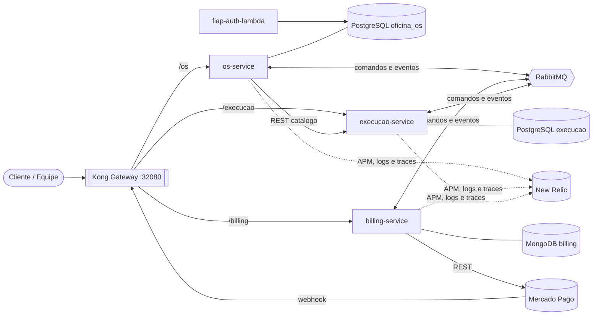
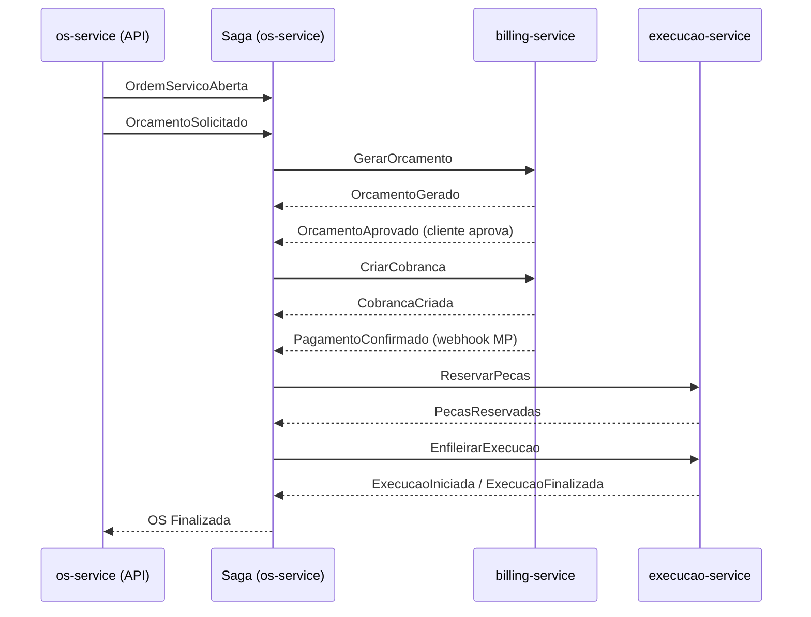

# Arquitetura — Fase 4 (Microsserviços + Saga orquestrada)

Documento-base do PDF de entrega do Tech Challenge Fase 4 (SOAT/FIAP). O monólito `fiap-app` (Fase 3) foi dividido em **3 microsserviços independentes** — cada um com repositório, banco, Dockerfile, manifestos Kubernetes e pipeline próprios — coordenados por **Saga orquestrada** sobre **RabbitMQ**, com pagamento via **Mercado Pago** e deploy automatizado em Kubernetes.

## 1. Repositórios

| Repositório | Papel |
|---|---|
| `oficina-os-service` | Clientes, veículos, equipe, OS e **orquestrador da Saga** |
| `oficina-billing-service` | Orçamento e pagamento (Mercado Pago, webhook, estorno) |
| `oficina-execucao-service` | Catálogo de serviços/peças, estoque, reservas e fila de execução |
| `fiap-infra-k8s` | Terraform: namespace, RabbitMQ, Kong (API Gateway) e rotas |
| `fiap-infra-db` | Postgres gerenciado (Railway) onde vive o database `oficina_os` |
| `fiap-auth-lambda` | Login do cliente por CPF → JWT (Railway Function); lê `clientes` de `oficina_os` |

## 2. Visão geral

Regra de ouro: **nenhum serviço acessa o banco de outro**. A integração é por mensagens (RabbitMQ) e, para validar itens, por REST no catálogo do execucao-service.

## 3. Por que essa divisão

| Serviço | Motivo da fronteira |
|---|---|
| os-service | Dono do ciclo de vida da OS e da identidade; precisa ser relacional (cliente → veículo → OS → itens → histórico) e concentra o estado da Saga e os timeouts |
| billing-service | Domínio financeiro com ciclo próprio (webhook, idempotência, estorno). Documentos de orçamento/pagamento aninham itens e não têm joins: **MongoDB** (com replica set para transações + outbox) |
| execucao-service | Estoque exige consistência forte (reserva/consumo atômicos) e fila de trabalho do mecânico; **PostgreSQL** |

Bancos: 2 SQL (PostgreSQL) e 1 NoSQL (MongoDB), atendendo ao requisito do enunciado.

## 4. Saga orquestrada

O orquestrador (`OrdemServicoStateMachine`, no os-service) conduz: **abre OS → gera orçamento → aprovação → cobrança/pagamento → reserva de peças → execução → finalização**, com **compensação** em cada etapa que pode falhar.

Compensações (estado `Compensando`): `CancelarOrcamento`, `LiberarPecas` e `EstornarPagamento`, conforme o ponto da falha; se o estorno falha ou o prazo estoura, a Saga vai a `AguardandoAcaoManual` e há reprocessamento por `POST /api/admin/ordens-servico/{id}/reprocessar-compensacao`. Diagrama de estados, tabela de mensagens e runbook: [README do os-service](../README.md).

### Garantias de consistência
- **Outbox transacional** em cada serviço (EF Core no os/execucao, MongoDB no billing): o dado e a mensagem confirmam juntos; o inbox descarta reentregas (idempotência por `MessageId`).
- **Concorrência otimista** no estado da Saga e nos agregados.
- **Timeouts** persistentes via Quartz.NET (sobrevivem a reinício).
- **Retry exponencial** (3x) em consumidores e fila `_error` para falhas técnicas; compensação só para falhas de negócio.

## 5. Mercado Pago

Integração REST atrás de `IGatewayPagamento`: Checkout Pro (`/checkout/preferences`), consulta de pagamento e estorno (`/v1/payments/{id}/refunds`). O webhook (`POST /webhooks/mercadopago`) valida `x-signature` (HMAC-SHA256 sobre `id:{data.id};request-id:{x-request-id};ts:{ts};`), **não confia no corpo** (consulta o pagamento na API) e é idempotente. `MercadoPago__Modo=Fake` (padrão) aprova na hora, sem rede, e é usado em testes e na demo; `FakeComportamento` = `Aprovar` | `Recusar` | `FalharEstorno`. Credenciais reais exigem URL pública (túnel) para o webhook.

## 6. Tecnologias

| Camada | Tecnologia |
|---|---|
| Runtime | .NET 10, ASP.NET Core, Clean Architecture (Domain/Application/Infrastructure/Api) |
| Mensageria | RabbitMQ 3.13 + MassTransit 8.x (State Machine, outbox, retry); Quartz.NET para timeouts |
| Dados | PostgreSQL (EF Core/Npgsql), MongoDB (`MongoDB.Driver`) |
| Segurança | JWT Bearer HS256 (`Oficina.Api`); roles Cliente, Atendente, Mecanico, Gerente |
| Gateway | Kong (rotas `/os`, `/billing`, `/execucao`, webhook sem rate limit) |
| Contêineres | Docker, Kubernetes (Deployment, Service, HPA, ConfigMap, Secret, Kustomize), Terraform |
| CI/CD | GitHub Actions: build → testes + cobertura ≥ 80% → SonarCloud → imagem GHCR → deploy (runner self-hosted) |
| Observabilidade | Serilog JSON, New Relic APM/Logs, `traceparent` W3C nas mensagens |
| Testes | xUnit, Reqnroll (BDD), Testcontainers, coverlet |

## 7. Contratos de mensagem

Copiados em cada repo (`Contracts/Mensagens.cs`, namespace `Oficina.Contracts`; o MassTransit roteia pelo nome completo do tipo), sem pacote compartilhado, para manter os repositórios independentes. Lista completa no [README do os-service](../README.md#mensagens-oficinacontracts-em-srcosapplicationcontractsmensagenscs).

## 8. Exposição e rotas

Proxy do Kong (NodePort 32080): `/os/...`, `/execucao/...`, `/billing/...` e `/billing/webhooks/mercadopago` (o Kong remove o prefixo e encaminha a `/api/...` ou `/webhooks/mercadopago`). RabbitMQ management: NodePort 31672 (Kubernetes) ou http://localhost:15672 (docker compose). Execução local direta: os 5001, billing 5002, execucao 5003.

## 9. Qualidade e entrega

- Testes unitários em todos os serviços; BDD da Saga no os-service (5 cenários); cobertura ≥ 80% de linhas exigida no build. Evidência nos READMEs de cada repositório.
- Pipeline por repositório com SonarCloud (opcional enquanto não há `SONAR_TOKEN`), imagem no GHCR e deploy `kubectl apply -k k8s/`.
- Dashboard New Relic com painel da Saga: [`observability/dashboard-fase4.json`](../observability/dashboard-fase4.json).
- Coleções Postman por serviço em `docs/*.postman_collection.json`; roteiro do vídeo em [`ROTEIRO-VIDEO-FASE4.md`](ROTEIRO-VIDEO-FASE4.md).
